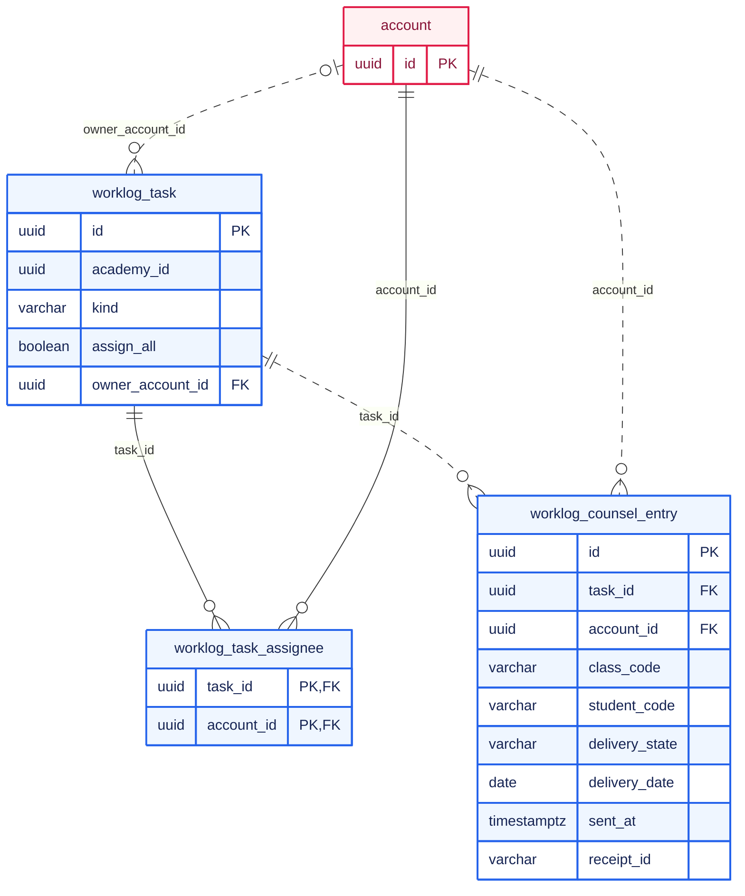

PostgreSQL에는 계정, 권한 원장과 감사 기록, 자료실의 메타데이터와 작업 원장, 업무일지를 두고, 자료실의 파일 본문과 외부 ERP가 원장인 반·학생·출결은 두지 않음.

## 전체 ERD

Flyway 마이그레이션 세 개가 만드는 26개 테이블 기준임. 누가 했는지를 적는 열(`created_by`, `granted_by`, `assigned_by`, `revoked_by`, `confirmed_by`, 감사 기록의 `actor_account_id`·`target_account_id`)은 모두 `account`를 가리키는 FK이지만 선으로 그리지 않았음. 열은 키만 적었고, 나머지 열은 아래 영역별 설명에 있음.

```mermaid caption="영역은 계정, 권한 원장, 자료실, 업무일지의 넷. 업무 모듈의 테이블은 다른 모듈의 테이블 가운데 account만 FK로 가리킴"
erDiagram
    %% legend: solid=식별 관계; dotted=비식별 관계; zero=없을 수 있음; many=여러 개
    direction TB
    subgraph identity_group["계정"]
        account {
            uuid id PK
            varchar username UK
        }
        identity_audit_log {
            uuid id PK
        }
    end
    subgraph access_group["권한 원장"]
        platform_superuser {
            uuid account_id PK, FK
        }
        academy_access_scope {
            uuid academy_id PK
        }
        staff_membership {
            uuid id PK
            uuid academy_id FK
            uuid account_id FK
        }
        academy_role {
            uuid id PK
            uuid academy_id FK
        }
        permission {
            varchar permission_key PK
        }
        role_permission {
            uuid role_id PK, FK
            varchar permission_key PK, FK
        }
        role_assignment {
            uuid id PK
            uuid academy_id FK
            uuid staff_membership_id FK
            uuid role_id FK
        }
        resource_acl {
            uuid id PK
            uuid academy_id FK
            uuid subject_account_id FK
            uuid subject_role_id FK
        }
        authorization_audit_log {
            uuid id PK
        }
    end
    subgraph storage_group["자료실"]
        storage_node {
            uuid id PK
            uuid parent_id FK
        }
        storage_operation {
            uuid id PK
            uuid target_node_id FK
        }
    end
    subgraph worklog_group["업무일지"]
        worklog_staff {
            uuid academy_id PK
            uuid account_id PK, FK
        }
        worklog_setting {
            uuid academy_id PK
        }
        worklog_tag {
            uuid id PK
        }
        worklog_task {
            uuid id PK
            uuid tag_id FK
            uuid owner_account_id FK
        }
        worklog_task_assignee {
            uuid task_id PK, FK
            uuid account_id PK, FK
        }
        worklog_task_status {
            uuid task_id PK, FK
            uuid account_id PK, FK
        }
        worklog_attachment {
            uuid id PK
            uuid owner_account_id FK
            uuid task_id FK
        }
        worklog_counsel_entry {
            uuid id PK
            uuid task_id FK
            uuid account_id FK
        }
        worklog_journal {
            uuid academy_id PK
            date report_date PK
        }
        worklog_journal_item {
            uuid id PK
            uuid academy_id FK
            date report_date FK
        }
        worklog_daily_report {
            uuid id PK
            uuid academy_id FK
            date report_date FK
            uuid account_id FK
        }
        worklog_notice {
            uuid id PK
            uuid author_account_id FK
        }
        worklog_event {
            uuid id PK
            uuid owner_account_id FK
            uuid tag_id FK
        }
    end
    account ||--o| platform_superuser : account_id
    academy_access_scope ||..o{ staff_membership : academy_id
    account ||..o{ staff_membership : account_id
    academy_access_scope ||..o{ academy_role : academy_id
    academy_role ||--o{ role_permission : role_id
    permission ||--o{ role_permission : permission_key
    staff_membership ||..o{ role_assignment : "academy_id, staff_membership_id"
    academy_role ||..o{ role_assignment : "academy_id, role_id"
    academy_access_scope ||..o{ resource_acl : academy_id
    account |o..o{ resource_acl : subject_account_id
    academy_role |o..o{ resource_acl : "academy_id, subject_role_id"
    storage_node |o..o{ storage_node : parent_id
    storage_node ||..o{ storage_operation : target_node_id
    account ||--o{ worklog_staff : account_id
    worklog_tag ||..o{ worklog_task : tag_id
    account |o..o{ worklog_task : owner_account_id
    worklog_task ||--o{ worklog_task_assignee : task_id
    account ||--o{ worklog_task_assignee : account_id
    worklog_task ||--o{ worklog_task_status : task_id
    account ||--o{ worklog_task_status : account_id
    worklog_task |o..o{ worklog_attachment : task_id
    account ||..o{ worklog_attachment : owner_account_id
    worklog_task ||..o{ worklog_counsel_entry : task_id
    account ||..o{ worklog_counsel_entry : account_id
    worklog_journal ||..o{ worklog_journal_item : "academy_id, report_date"
    worklog_journal ||..o{ worklog_daily_report : "academy_id, report_date"
    account ||..o{ worklog_daily_report : account_id
    account ||..o{ worklog_notice : author_account_id
    account |o..o{ worklog_event : owner_account_id
    worklog_tag |o..o{ worklog_event : tag_id
    classDef identity fill:#fff1f2,stroke:#e11d48,color:#881337,stroke-width:2px
    classDef access fill:#f5f3ff,stroke:#7c3aed,color:#3b0764,stroke-width:2px
    classDef storage fill:#fff7ed,stroke:#ea580c,color:#7c2d12,stroke-width:2px
    classDef worklog fill:#eff6ff,stroke:#2563eb,color:#172554,stroke-width:2px
    class identity_group,account,identity_audit_log identity
    class access_group,platform_superuser,academy_access_scope,staff_membership,academy_role,permission,role_permission,role_assignment,resource_acl,authorization_audit_log access
    class storage_group,storage_node,storage_operation storage
    class worklog_group,worklog_staff,worklog_setting,worklog_tag,worklog_task,worklog_task_assignee,worklog_task_status,worklog_attachment,worklog_counsel_entry,worklog_journal,worklog_journal_item,worklog_daily_report,worklog_notice,worklog_event worklog
```

## 스키마의 특징

- **모듈 사이에는 FK가 거의 없음(P2)**: 업무 모듈의 테이블은 `account`만 FK로 가리킴. 자료실 노드를 가리키는 `resource_acl.resource_id`, 학원을 가리키는 업무일지의 `academy_id`에는 FK가 없음. 권한 원장이 자료실 테이블을, 업무일지가 권한 테이블을 알지 못하게 하기 위함이며, 그 대가로 지운 노드의 허용 목록은 애플리케이션이 정리함
- **정책 버전이 학원마다 한 행에 있음(P1)**: `academy_access_scope.policy_version`은 그 학원의 역할·권한·배정·허용 목록 가운데 무엇이 바뀌어도 1씩 오름. 정책을 바꾸는 요청은 이 행을 잠그고 버전을 비교함
- **같은 학원의 것끼리만 연결되게 복합 FK를 씀(P1)**: 역할 배정은 `(academy_id, staff_membership_id)`와 `(academy_id, role_id)`로, 허용 목록의 역할 주체는 `(academy_id, subject_role_id)`로 가리킴. 다른 학원의 역할을 배정하거나 허용 대상으로 넣는 행은 DB가 거부함
- **상태는 CHECK 제약으로 닫아 둠(P3)**: 상태 열은 허용하는 값만 받고, 상태와 함께 움직여야 하는 열을 묶어 둠. 보낸 상담에만 전송 시각이 있고, 제출된 보고에만 확인 표시가 붙으며, 종료된 소속에만 종료 시각이 있음
- **하려는 일을 적는 표가 따로 있음(P3)**: `storage_operation`은 저장소에 닿는 작업을 실행 전에 기록하는 원장이고, 상담은 행 자체의 `delivery_state`가 같은 역할을 함

## 주요 관계 상세

### 역할의 권한과 리소스의 허용

```mermaid caption="접근 하나가 허용되려면 소속에서 역할을 거쳐 권한에 닿는 길과, 리소스의 허용 목록에서 그 계정이나 역할에 닿는 길이 모두 있어야 함"
erDiagram
    %% legend: solid=식별 관계; dotted=비식별 관계; zero=없을 수 있음; many=여러 개
    direction TB
    account {
        uuid id PK
    }
    academy_access_scope {
        uuid academy_id PK
        bigint policy_version
    }
    staff_membership {
        uuid id PK
        uuid academy_id FK
        uuid account_id FK
        varchar status
    }
    academy_role {
        uuid id PK
        uuid academy_id FK
        varchar status
    }
    role_assignment {
        uuid id PK
        uuid academy_id FK
        uuid staff_membership_id FK
        uuid role_id FK
        timestamptz revoked_at
    }
    role_permission {
        uuid role_id PK, FK
        varchar permission_key PK, FK
    }
    permission {
        varchar permission_key PK
    }
    resource_acl {
        uuid id PK
        uuid academy_id FK
        varchar resource_type
        uuid resource_id
        uuid subject_account_id FK
        uuid subject_role_id FK
        varchar action
        boolean inherit_to_children
    }
    account ||..o{ staff_membership : account_id
    academy_access_scope ||..o{ staff_membership : academy_id
    academy_access_scope ||..o{ academy_role : academy_id
    staff_membership ||..o{ role_assignment : "academy_id, staff_membership_id"
    academy_role ||..o{ role_assignment : "academy_id, role_id"
    academy_role ||--o{ role_permission : role_id
    permission ||--o{ role_permission : permission_key
    academy_access_scope ||..o{ resource_acl : academy_id
    account |o..o{ resource_acl : subject_account_id
    academy_role |o..o{ resource_acl : "academy_id, subject_role_id"
    classDef access fill:#f5f3ff,stroke:#7c3aed,color:#3b0764,stroke-width:2px
    classDef identity fill:#fff1f2,stroke:#e11d48,color:#881337,stroke-width:2px
    class academy_access_scope,staff_membership,academy_role,role_assignment,role_permission,permission,resource_acl access
    class account identity
```

| 테이블 | 책임 | 제약 |
| --- | --- | --- |
| `staff_membership` | 계정의 학원 소속 | 계정·학원마다 활성 소속은 하나. 종료하면 행을 지우지 않고 상태와 종료 시각을 적음 |
| `academy_role` | 학원이 만든 역할 | 같은 학원 안에서 정규화한 이름이 겹치지 않음. 지우지 않고 비활성화함 |
| `role_assignment` | 소속에 역할을 배정 | 회수하면 `revoked_at`을 적음. 회수되지 않은 배정만 판단에 씀 |
| `permission` | 코드가 정한 권한 키 | 행의 집합이 코드의 목록과 같은지 테스트로 확인함 |
| `resource_acl` | 리소스 하나에 대한 허용 한 건 | 주체는 계정과 역할 가운데 정확히 하나. 같은 대상·주체·작업의 허용은 한 건만 |

허용 목록에는 거부 행이 없음. 일치하는 허용이 없으면 거부이고, 하위 폴더의 설정이 상위에서 내려온 허용을 취소하지 못함.

### 상담과 전송 상태



`(task_id, account_id, class_code, student_code)`가 고유해서 명단을 여러 번 가져와도 같은 학생의 상담이 두 건 생기지 않음. `delivery_state`는 `IDLE`, `PENDING`, `SENT`만 받고, `sent_at`은 `SENT`일 때만 값이 있음. `delivery_date`는 보내려 한 날짜로, 결과를 모르는 전송을 외부 ERP의 그날 기록과 대조할 때 씀.

`worklog_task_assignee`에는 골라서 배정한 담당자와 특강상담의 고정 담당자만 들어감. 전원에게 배정한 업무는 `assign_all`만 적고 담당자 행을 만들지 않음. 개인 상담일정만 `owner_account_id`를 가지며 CHECK 제약이 종류와 소유자의 짝을 강제함.

<details><summary>그 밖의 테이블</summary>

| 테이블 | 저장하는 것 | 눈여겨볼 제약 |
| --- | --- | --- |
| `account` | 로그인 아이디, 표시 이름, 비밀번호 해시, 상태 | 아이디 고유 |
| `platform_superuser` | 플랫폼 슈퍼유저 등록 | 학원의 역할과 분리된 별도 표 |
| `identity_audit_log`, `authorization_audit_log` | 계정 변경, 권한 판단과 정책 변경의 기록 | 권한 감사에는 정책 버전과 변경 전후 상태(JSON)를 적음 |
| `storage_node` | 파일·폴더의 이름, 부모, 상태, 외부 경로 | 폴더에는 크기와 미디어 타입이 없음. 휴지통 상태와 버린 시각이 함께 움직임 |
| `storage_operation` | 저장소 작업의 종류, 대상, 상태, 시도 횟수, 마지막 오류 | 상태와 종류를 CHECK로 제한 |
| `worklog_staff` | 외부 ERP 직원 코드와 가져온 담당 반(JSON) | 학원·계정마다 한 행 |
| `worklog_task_status` | 담당자별 처리 상태와 텍스트 보고 | 업무·계정마다 한 행 |
| `worklog_attachment` | 업무 보고나 체크리스트 항목에 붙인 파일(4MB 이하, DB에 저장) | 업무 보고의 것이거나 체크리스트의 것 가운데 하나 |
| `worklog_journal`, `worklog_journal_item` | 날짜별 일일보고 정의와 체크리스트 항목 | 학원·날짜마다 하나. 지우면 항목과 낸 보고가 함께 지워짐 |
| `worklog_daily_report` | 낸 일일보고와 내용(JSON) | 학원·계정·날짜마다 하나 |
| `worklog_tag`, `worklog_notice`, `worklog_event`, `worklog_setting` | 태그, 공지, 일정, 학원별 설정 | 일정은 개인일정만 소유자를 가짐 |

</details>
