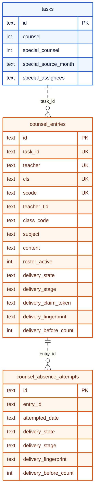
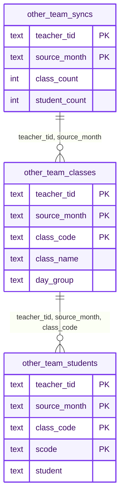

DB에는 계정, 업무와 처리 상태, 일일보고, 상담의 작성 내용과 전송 상태, 외부 ERP에서 가져온 반·명단의 스냅샷을 두고, 출결·성적·알림장 본문처럼 외부 ERP가 원장인 기록은 필요할 때 읽기만 하고 두지 않음.

## 전체 ERD

SQLite 스키마가 만드는 17개 테이블 기준임.[* 스키마(`src/db/schema.ts`), 기존 DB에 열을 더하는 이관(`src/db/db.service.ts`)] 스키마에는 FK 제약이 없어서, 선은 코드가 테이블을 잇는 논리적 연결을 그린 것임. 이름 문자열로 잇는 연결은 관계 이름에 `(이름)`을 붙였음. 열은 키만 적었음.

```mermaid caption="영역은 계정, 업무, 일일보고, 상담, 반 스냅샷, 운영의 여섯. 상담과 일일보고는 강사를 이름으로, 반 스냅샷은 강사 식별자로 가리킴"
erDiagram
    %% legend: solid=식별 관계; dotted=비식별 관계; zero=없을 수 있음; many=여러 개
    direction TB
    subgraph account_group["계정"]
        teachers {
            text tid PK
            text name
        }
        lead_account {
            text id PK
        }
    end
    subgraph task_group["업무"]
        tags {
            text name PK
        }
        tasks {
            text id PK
            text tag
            text created_by_tid
        }
        task_status {
            text task_id PK
            text teacher PK
        }
        events {
            text id PK
            text owner
        }
    end
    subgraph journal_group["일일보고"]
        journals {
            text date PK
        }
        journal_items {
            text id PK
            text date
        }
        daily_reports {
            text id PK
            text teacher UK
            text date UK
        }
    end
    subgraph counsel_group["상담"]
        counsel_entries {
            text id PK
            text task_id UK
            text teacher UK
            text cls UK
            text scode UK
            text teacher_tid
        }
        counsel_absence_attempts {
            text id PK
            text entry_id
        }
    end
    subgraph snapshot_group["반 스냅샷"]
        special_class_roster {
            text source_month PK
            text class_code PK
            text scode PK
            text teacher_tid
        }
        other_team_syncs {
            text teacher_tid PK
            text source_month PK
        }
        other_team_classes {
            text teacher_tid PK
            text source_month PK
            text class_code PK
        }
        other_team_students {
            text teacher_tid PK
            text source_month PK
            text class_code PK
            text scode PK
        }
    end
    subgraph ops_group["운영"]
        settings {
            text k PK
        }
        notices {
            text id PK
        }
    end
    tags ||..o{ tasks : "tag (이름)"
    teachers |o..o{ tasks : created_by_tid
    tasks ||--o{ task_status : task_id
    teachers ||--o{ task_status : "teacher (이름)"
    teachers |o..o{ events : owner
    journals ||..o{ journal_items : date
    journals ||..o{ daily_reports : date
    teachers ||..o{ daily_reports : "teacher (이름)"
    tasks ||..o{ counsel_entries : task_id
    teachers ||..o{ counsel_entries : teacher_tid
    counsel_entries ||..o{ counsel_absence_attempts : entry_id
    teachers ||..o{ special_class_roster : teacher_tid
    teachers ||--o{ other_team_syncs : teacher_tid
    other_team_syncs ||--o{ other_team_classes : "teacher_tid, source_month"
    other_team_classes ||--o{ other_team_students : "teacher_tid, source_month, class_code"
    classDef account fill:#fff1f2,stroke:#e11d48,color:#881337,stroke-width:2px
    classDef task fill:#eff6ff,stroke:#2563eb,color:#172554,stroke-width:2px
    classDef journal fill:#f0fdfa,stroke:#0d9488,color:#134e4a,stroke-width:2px
    classDef counsel fill:#fff7ed,stroke:#ea580c,color:#7c2d12,stroke-width:2px
    classDef snapshot fill:#f5f3ff,stroke:#7c3aed,color:#3b0764,stroke-width:2px
    classDef ops fill:#f1f5f9,stroke:#64748b,color:#1e293b,stroke-width:2px
    class account_group,teachers,lead_account account
    class task_group,tags,tasks,task_status,events task
    class journal_group,journals,journal_items,daily_reports journal
    class counsel_group,counsel_entries,counsel_absence_attempts counsel
    class snapshot_group,special_class_roster,other_team_syncs,other_team_classes,other_team_students snapshot
    class ops_group,settings,notices ops
```

`lead_account`는 강사가 아닌 마스터 팀장 계정 하나를 둠. `events.owner`는 강사 식별자 말고도 팀장과 팀 전체를 뜻하는 값을 받음. `settings`는 특강기간, 주간테스트 날짜, 마지막 동기화 결과, 강사 반 정보의 잠금 행을 키와 값으로 둠.

## 스키마의 특징

- **FK 제약 없이 코드가 관계를 지킴**: 강사를 지우면 그 강사의 처리 상태, 보고, 상담, 스냅샷을 한 트랜잭션에서 함께 지우고, 태그 이름을 바꾸면 그 태그를 쓰는 업무와 일정도 함께 고침. 그 대가로 새 테이블을 더할 때 정리 코드를 빠뜨리면 남는 행을 DB가 막지 않음[* 강사 삭제와 태그 이름 변경(`src/api/store.service.ts`의 `deleteTeacher`·`updateTag`)]
- **강사를 이름으로 잇는 열이 남아 있음**: 처리 상태, 일일보고, 상담은 강사 이름으로 강사를 가리킴. 상담에는 이름이 바뀌거나 같은 이름이 생겨도 흔들리지 않게 강사 식별자(`teacher_tid`) 열을 더했고, 오래된 화면이 보낸 상담 ID는 강사 식별자를 포함한 자연키로만 다시 찾음
- **상담 행이 전송 기록을 겸함(P1)**: 상담 하나는 학생마다 한 행이고, 그 행의 `delivery_*` 열이 전송 단계·선점 토큰·내용 지문·보내기 전 건수를 담음. 지문은 상담 원문 대신 SHA-256 값을 저장함
- **만든 시점의 값을 복사해 둠(P3)**: `journals.special_period`는 날짜를 만들 때의 특강기간 여부를, `tasks.special_source_month`·`special_assignees`는 특강상담을 만들 때의 대상 월과 담당자를 저장함. 고정한 학생 명단은 그 업무의 상담 행으로 복사함
- **목록 값은 JSON 문자열로 둠**: 업무의 배정 범위(`scope`), 참고 링크, 강사의 반 묶음(`teachers.classes`), 일일보고의 단계별 작성 내용(`payload`)은 JSON 열임. 업무 보고의 첨부도 파일당 4MB 이하의 base64 문자열로 행에 들어감. 조회는 한 번에 끝나지만 이 값들 안쪽은 DB가 검사하지 않음

## 주요 관계 상세

### 상담과 전송 기록

상담 업무 하나에 강사·반·학생마다 상담 행이 하나씩 생기고(`task_id, teacher, cls, scode` 고유), 부재·문자 연락은 한 학생에게 여러 번 남길 수 있어 별도 테이블에 한 건씩 쌓임. 두 테이블 모두 행마다 전송 단계를 따로 가짐.



| 열 | 뜻 |
| --- | --- |
| `delivery_state` | `idle`(보내지 않음), `pending`(결과 확인 중), `confirmed`(외부 ERP에서 확인됨) |
| `delivery_stage` | `pending` 안의 단계. `claimed`는 외부 ERP에 닿기 전, `posting`은 보내기 시작한 뒤 |
| `delivery_claim_token` | 선점한 요청의 임의 토큰. 다른 요청이 단계를 바꾸지 못하게 조건에 넣음. 응답에는 내보내지 않음 |
| `delivery_fingerprint` | 날짜·주제·내용의 SHA-256. 같은 내용의 재요청을 알아보는 데 씀 |
| `delivery_before_count` | 보내기 직전 외부 ERP에 있던 같은 상담의 수. 보낸 뒤 다시 읽은 수와 비교함 |
| `roster_active` | 최신 명단에 있는지. 명단에서 빠져도 행을 지우지 않고 이 값만 끔 |

### 다른 팀의 반 스냅샷

다른 팀은 본인 계정으로 담당 반과 학생을 불러오고, 불러온 달마다 스냅샷을 쌓음. 동기화 한 번(`other_team_syncs`)이 반 목록(`other_team_classes`)을, 반이 학생 목록(`other_team_students`)을 품는 식별 관계라서, 학생이 0명인 반도 남고 새 달을 불러와도 지난 달의 상담 이력이 지워지지 않음. 기존 학생이 빠지는 동기화는 외부 ERP를 한 번 더 읽어 결과가 같을 때만 적용함.[* 다른 팀 동기화의 확인 읽기(`other-team-api.test.cjs`)]



<details><summary>그 밖의 영역</summary>

| 테이블 | 책임 | 키와 규칙 |
| --- | --- | --- |
| `teachers` | 강사와 팀장 권한, 다른 팀 권한, 반 묶음(JSON), 외부 ERP 계정 | `tid` PK. 반 묶음은 월수금·화목토와 특강 월수금·화목토 네 묶음 |
| `tasks` | 업무 정의. 종류는 `mt`·`counsel`·`special_counsel`·`self_managed` 표시로 구분 | `id` PK. 같은 요청 식별자로 다시 만들면 같은 ID가 나오도록 요청 식별자의 해시로 ID를 만듦 |
| `task_status` | 강사별 업무 처리 상태와 보고 | `(task_id, teacher)` PK. MT 업무는 `m_done`·`t_done`에서 상태를 계산함 |
| `journals`·`journal_items` | 날짜별 일일보고 정의와 체크리스트 항목 | `date` PK, 항목은 `id` PK |
| `daily_reports` | 강사의 일일보고 | `(teacher, date)` 고유. `status`는 `draft`·`submitted`, `confirmed`는 제출된 보고에만 유효 |
| `special_class_roster` | 특강 반별 월간 명단. 특강상담을 만들 때의 원본 | `(source_month, class_code, scode)` PK. 같은 달을 다시 동기화하면 교체됨 |
| `events`·`notices`·`tags`·`settings` | 일정, 공지, 업무 태그, 전역 설정 | `상담` 태그는 상담 업무가 쓰므로 지우거나 이름을 바꿀 수 없음 |

</details>
