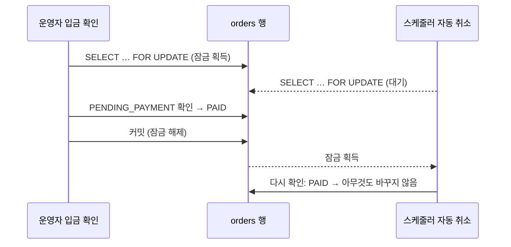

[담담공방 쇼핑몰](/ken-blog/post/project-a3d53a55-de01-4888-9e9a-02e34f2579bb/)은 주문할 때 재고를 빼고, 입금 기한이 지난 주문을 주기 작업이 취소해 재고를 되돌림. 무통장 입금만 받고 옵션 하나의 재고가 1~3개인 조건에서, 갈림길 16곳마다 두 방식을 비교해 고른 결과임. 조건이 바뀌면 답도 바뀜.

## 전제 조건

- 결제 수단은 무통장 입금 하나. 주문과 입금 사이에 몇 시간에서 며칠이 비고, 입금은 운영자가 통장을 보고 직접 확인함.
- 수제품이라 옵션당 재고가 1~3개인 경우가 많음. 한 개 차이가 곧 품절 여부.
- API는 1대, DB는 PostgreSQL 1대(READ COMMITTED). Redis·메시지 큐·외부 결제(PG) 없음.
- 주문할 때 이메일을 받지 않고 SMS도 보내지 않음. 고객에게 알릴 수단은 화면뿐.
- 모든 쿼리는 잠금 대기를 포함해 5초 안에 끝나야 함(`statement_timeout=5000`).

## 주문 상태와 재고

```mermaid caption="주문을 만들 때 재고가 빠지고, 취소되면 돌아옴. 전액 환불은 운영자가 재입고를 고른 경우에만 재고를 되돌림. 취소와 전액 환불에서 나가는 전이는 없음"
stateDiagram-v2
    state "결제 대기" as PENDING
    state "입금 확인" as PAID
    state "제작·배송 준비" as PROCESSING
    state "완료" as COMPLETED
    state "취소" as CANCELED
    state "전액 환불" as REFUNDED
    [*] --> PENDING: 주문 생성, 재고 차감
    PENDING --> PAID: 운영자가 입금 확인
    PENDING --> CANCELED: 고객·운영자 취소, 기한 경과
    PAID --> CANCELED: 운영자 취소
    PAID --> PROCESSING
    PROCESSING --> COMPLETED
    PAID --> REFUNDED
    PROCESSING --> REFUNDED
    COMPLETED --> REFUNDED
```

## 한눈에 보기

| # | 갈림길 | 선택 | 버린 쪽 |
|---|---|---|---|
| 1 | 재고를 빼는 시점 | 주문할 때 | 입금 확인할 때 |
| 2 | 미입금 주문의 재고 회수 | 입금 기한 + 자동 취소 | 운영자가 직접 취소 |
| 3 | 묶인 재고를 기록하는 곳 | 재고 컬럼 직접 차감 | 예약 테이블 |
| 4 | 기한을 세는 방식 | 달력 기준(주문일 + N일 23:59) | 경과 시간 기준(주문 + N시간) |
| 5 | 기한을 두는 곳 | 주문에 저장 | 조회할 때 계산 |
| 6 | 기한 일수를 정하는 주체 | 운영 설정 | 코드 상수 |
| 7 | 기한이 지난 주문을 처리하는 시점 | 5분마다 주기 실행 | 조회·주문 시점에 지연 처리 |
| 8 | 취소 대상을 잡는 방식 | 잠금 없이 고른 뒤 건별 트랜잭션 | 한 트랜잭션에서 `SKIP LOCKED` 일괄 |
| 9 | 중복 실행 방지 | 행 잠금 + 재확인 | 분산 락 |
| 10 | 동시 주문의 순서 정하기 | 비관적 락 | 조건부 `UPDATE` |
| 11 | 음수 재고를 막는 곳 | 앱 검증 + DB `CHECK` | 앱 검증만 |
| 12 | 재고의 정본 | 현재 수량 컬럼 + 이력 | 이력 합계만 |
| 13 | 자동 취소 뒤에 들어온 입금 | 운영자가 환불 | 취소 주문 되살리기 |
| 14 | 환불할 때의 재고 | 운영자가 선택 | 자동 복원 |
| 15 | 기한 연장 | 운영자가 연장 | 연장 불가 |
| 16 | 이미 있던 결제 대기 주문 | 적용일 기준으로 새 기한 | 주문일 기준 기한 |

## 1. 재고를 빼는 시점

마지막 1개를 두 고객이 거의 동시에 주문하는 경우가 기준 장면.

| 기준 | A. 주문할 때 차감 | B. 입금 확인할 때 차감 |
|---|---|---|
| 품절을 아는 시점 | 주문 버튼을 누를 때 | 운영자가 입금을 확인할 때 |
| 초과 판매 | 없음. 주문 트랜잭션이 옵션 행을 잠그고 재고를 확인 | 가능. 재고 1개에 주문 여러 건이 쌓이고 먼저 확인된 한 건만 성공 |
| 돈이 오간 뒤의 실패 | 없음 | 있음. 입금한 고객에게 품절을 알리고 환불해야 함 |
| 미입금 주문의 영향 | 입금 전까지 재고가 묶여 실제로는 남은 물건이 품절로 보임 | 없음. 입금 전에는 재고가 그대로 |
| 장난·허수 주문 | 재고를 잠그는 공격이 됨 | 영향 없음 |
| 필요한 부속 장치 | 입금 기한과 자동 취소 | 품절 환불 절차, 고객 연락 수단 |

**선택: A.** B의 실패는 돈이 오간 뒤에 드러나고, 고객에게 알릴 수단이 화면밖에 없어 수습 비용이 큼. 재고가 1~3개인 상품에서는 B의 충돌이 드문 일이 아님. A의 약점인 재고 묶임은 기한을 두면 상한이 생김(2번).

**A가 치르는 비용.** 기한 동안은 허수 주문이 재고를 잡음. 기본 2일 기준으로 최대 약 3일. 로그인한 회원만 주문할 수 있어 무제한은 아니지만, 한 회원의 결제 대기 주문은 5건까지만 받음.

## 2. 미입금 주문의 재고 회수

| 기준 | A. 입금 기한 + 자동 취소 | B. 운영자가 직접 취소 |
|---|---|---|
| 재고가 묶이는 시간 | 기한까지로 상한이 있음 | 운영자가 볼 때까지. 상한 없음 |
| 운영 부담 | 없음 | 미입금 주문을 주기적으로 찾아 취소해야 함 |
| 고객 경험 | 기한을 넘기면 주문이 사라짐. 화면 안내가 필수 | 늦게 입금해도 주문이 살아 있음 |
| 잘못 취소될 위험 | 기한 직전 입금을 운영자가 늦게 확인하면 취소됨 | 없음 |
| 구현 | 기한 컬럼, 스케줄러, 경쟁 처리 | 없음(변경 전 방식) |

**선택: A.** B는 사람이 잊으면 재고가 영원히 묶임. 변경 전 코드가 B였고, 실제로 결제 대기 주문은 누가 취소하기 전까지 재고를 잡고 있었음.

**A가 치르는 비용.** 입금했는데 확인 전에 기한이 지나는 경우가 생김. 대시보드의 "오늘 기한 마감 N건"과 주문 목록의 마감 배지로 운영자가 먼저 보게 하고, 필요하면 기한을 늘릴 수 있게 함(15번). 그래도 놓치면 13번의 수동 환불로 감.

## 3. 묶인 재고를 기록하는 곳

| 기준 | A. 재고 컬럼 직접 차감 | B. 예약 테이블(가용 = 재고 − 활성 예약 합) |
|---|---|---|
| 재고 숫자의 뜻 | 지금 팔 수 있는 수량 | 창고에 있는 수량. 팔 수 있는 수량은 따로 계산 |
| 목록·상세 조회 | 컬럼 하나를 읽음 | 예약 합계를 빼는 조인 또는 하위 조회가 매번 필요 |
| 회수 방식 | 취소 트랜잭션이 재고를 다시 더함 | 예약 행의 상태만 바꾸면 됨 |
| 실물과 맞추기 | 입금 대기분만큼 실물보다 적게 보임 | 실물 수량과 같아 재고 실사에 유리 |
| 상태의 개수 | 주문 상태 하나 | 주문 상태와 예약 상태 둘. 서로 어긋날 수 있음 |
| 적합한 경우 | 결제가 느리고 주문량이 적은 곳 | 결제창에 머무는 몇 분만 잡아 두는 PG 결제 |

**선택: A.** 예약 테이블은 "결제창에서 5분 동안만 잡아 둔다" 같은 짧은 점유에 맞음. 무통장 입금은 점유가 며칠이고 그 기간이 곧 주문의 결제 대기 상태라, 예약을 따로 두면 같은 사실을 두 군데에 적게 됨. 기존 코드에는 예약 테이블과 5분 주기 만료 스케줄러가 있었지만 예약을 만드는 호출이 한 군데도 없었음. V6에서 테이블과 코드를 지움.

**A가 치르는 비용.** "창고에 실제로 몇 개 있나"를 한 번에 알 수 없음. 필요하면 재고에 결제 대기 주문 수량을 더해 구해야 함.

## 4. 기한을 세는 방식

| 기준 | A. 달력 기준: 주문일(한국 시간) + N일의 23:59:59 | B. 경과 시간 기준: 주문 시각 + N×24시간 |
|---|---|---|
| 고객 안내 | "10월 13일(화) 23:59까지" | "10월 13일 02:20까지" |
| 기억하기 | 날짜 하나만 기억 | 분 단위 시각을 기억해야 함 |
| 실제 대기 시간 | 주문 시각에 따라 N일 ~ N+1일. 들쭉날쭉함 | 항상 정확히 N일 |
| 은행 점검 시간 | 23:59 마감이라 자정 전후 점검과 겹칠 수 있음 | 마감 시각이 흩어져 영향이 분산됨 |
| 운영자 확인 리듬 | 하루 한 번, 그날 마감 건만 보면 됨 | 마감이 하루 종일 흩어져 있음 |
| 시간대 의존 | 있음. 서버가 UTC라도 한국 날짜로 계산해야 함 | 없음 |

**선택: A.** 고객이 기억할 것은 날짜 하나이고, 운영자는 "오늘 마감"만 보면 됨. 계산은 `PaymentDeadlinePolicy.dueAt`이 `Asia/Seoul` 날짜로 함.

**A가 치르는 비용.** 밤 11시 50분 주문과 0시 10분 주문의 기한이 하루 차이 남. N=1이면 늦은 밤 주문이 24시간 남짓만 받으므로 기본값을 2로 둠.

## 5. 기한을 두는 곳

| 기준 | A. 주문에 저장(`orders.paymentDueAt`) | B. 조회할 때 계산(`createdAt` + 현재 설정) |
|---|---|---|
| 설정을 바꿨을 때 | 이미 들어온 주문은 그대로 | 모든 결제 대기 주문의 기한이 함께 바뀜 |
| 고객에게 한 약속 | 주문할 때 안내한 날짜가 유지됨 | 3일에서 1일로 줄이면 안내한 날짜보다 먼저 취소됨 |
| 주문별 연장 | 컬럼 값만 바꾸면 됨 | 불가. 별도 컬럼이 결국 필요 |
| 조회 조건 | `paymentDueAt <= now()`. 부분 인덱스 사용 | 설정값을 읽어 식으로 비교. 인덱스를 타기 어려움 |
| 마이그레이션 | 컬럼 추가와 기존 주문 채우기 필요 | 필요 없음 |

**선택: A.** 기한은 주문 시점에 고객에게 한 약속이라 주문과 함께 고정돼야 함. 자동 취소 조회는 `WHERE status = 'PENDING_PAYMENT'`인 부분 인덱스(`idx_orders_pending_payment_due`)를 써서 결제 대기 주문 수에만 비례함.

**A가 치르는 비용.** 설정을 잘못 넣은 채 받은 주문은 설정을 고쳐도 그대로임. 주문별로 기한을 고쳐야 함.

## 6. 기한 일수를 정하는 주체

| 기준 | A. 운영 설정(`bank_transfer_due_days`) | B. 코드 상수 |
|---|---|---|
| 바꾸는 방법 | 설정 화면에서 저장 | 코드 수정과 배포 |
| 잘못된 값 | 들어올 수 있음. 검증이 필요 | 없음 |
| 명절·휴가 대응 | 운영자가 바로 늘림 | 개발자가 필요 |
| 값이 없을 때 | 기본값으로 떨어져야 함 | 해당 없음 |

**선택: A.** 연휴에는 은행 업무가 멈춰 기한을 늘려야 하고, 그 판단은 운영자가 함. 저장할 때 1~30 사이 정수만 받고(아니면 400), 비어 있거나 읽을 수 없는 값이면 기본 2일로 계산해 주문이 실패하지 않게 함.

**A가 치르는 비용.** 주문 생성마다 설정 한 행을 읽음(PK 조회 1회).

## 7. 기한이 지난 주문을 처리하는 시점

| 기준 | A. 주기 실행(5분마다) | B. 지연 처리(주문·조회 요청이 들어올 때 확인) |
|---|---|---|
| 재고가 돌아오는 시점 | 기한 뒤 최대 5분 | 누군가 그 상품을 보거나 주문할 때 |
| 요청 경로의 부담 | 없음 | 상품 조회·주문마다 만료 확인과 쓰기가 끼어듦 |
| 읽기 요청의 성격 | 읽기는 읽기만 함 | 조회가 재고를 바꿈. 읽기 전용 트랜잭션을 못 씀 |
| 방문이 없을 때 | 그래도 처리됨 | 주문 상태가 계속 결제 대기로 남음. 대시보드 숫자가 틀림 |
| 인프라 | 스케줄러 스레드 하나 | 없음 |
| 장애 시 | 다음 실행에서 밀린 것을 처리 | 다음 요청에서 처리 |

**선택: A.** B는 "아무도 안 보면 영원히 결제 대기"가 되어 주문 목록과 대시보드가 사실과 달라짐. 5분 지연은 며칠짜리 기한에서 의미가 없음. Redis의 키 만료 알림이나 지연 큐는 쓰지 않는 인프라를 새로 들여야 해서 제외함.

**A가 치르는 비용.** 기한이 지나도 최대 5분은 재고가 묶여 있고, 그 5분 사이에는 운영자가 기한 지난 주문에 입금 확인을 할 수 있음. 의도한 동작임. 기한 직후라도 사람이 입금을 확인했다면 그 주문은 살리는 편이 맞음.

## 8. 취소 대상을 잡는 방식

| 기준 | A. 잠금 없이 ID를 고른 뒤 주문마다 트랜잭션 | B. 한 트랜잭션에서 `FOR UPDATE SKIP LOCKED`로 일괄 |
|---|---|---|
| 트랜잭션 길이 | 주문 1건(주문 행 + 그 주문의 옵션 행) | 대상 전체. 건수에 비례 |
| 한 건의 실패 | 그 주문만 롤백, 나머지는 진행 | 전체 롤백 또는 세이브포인트 필요 |
| 잠금 보유 | 짧게 여러 번 | 많은 주문·옵션 행을 길게 |
| 5초 제한 | 건별로 적용돼 여유 있음 | 건수가 많으면 넘을 수 있음 |
| 후보가 낡을 수 있음 | 있음. 잠근 뒤 다시 확인해야 함 | 없음. 고른 순간 잠김 |
| 일하는 프로세스가 여럿일 때 | 같은 후보를 서로 집지만 재확인으로 한 번만 처리 | 서로 다른 행을 나눠 가져감 |

**선택: A.** 자동 취소는 재고 복원 때문에 옵션 행도 잠그는데, 옵션 행은 고객 주문과 다투는 자원임. 잠금을 오래 쥐면 그 상품의 주문이 5초 제한에 걸림. 한 주문의 실패(데이터 이상 등)가 다른 주문의 취소를 막지 않는 것도 중요함.

**A가 치르는 비용.** 후보 조회와 처리 사이에 상태가 바뀔 수 있어 "잠근 뒤 재확인"이 필수(9번). 한 번에 최대 500건만 집고 나머지는 다음 실행으로 넘김.

## 9. 중복 실행 방지

스케줄러가 같은 주문을 두 번 취소하면 재고가 두 번 돌아옴. API를 여러 대로 늘리면 인스턴스마다 스케줄러가 돎.

| 기준 | A. 행 잠금 + 재확인(여러 번 실행돼도 결과가 같게) | B. 분산 락(ShedLock 등으로 한 인스턴스만 실행) |
|---|---|---|
| 막는 것 | 같은 주문의 중복 처리 | 작업 자체의 동시 실행 |
| 운영자 요청과의 경쟁 | 같은 잠금으로 함께 해결 | 해결 못 함. 입금 확인은 스케줄러 락과 무관 |
| 추가 구성 | 없음 | 락 테이블과 라이브러리, 락 유지 시간 설정 |
| 실패 방식 | 재확인을 빠뜨리면 조용히 중복 처리 | 락 시간이 작업보다 짧으면 동시 실행 |
| 낭비 | 인스턴스마다 후보를 조회 | 한 인스턴스만 일함 |

**선택: A.** 분산 락을 써도 "스케줄러 vs 운영자의 입금 확인" 경쟁은 그대로 남아 행 잠금이 어차피 필요함. 그렇다면 행 잠금 하나로 두 문제를 모두 푸는 편이 단순함.

동작 순서는 다음과 같음.



반대로 스케줄러가 먼저 잠그면 주문이 취소되고 재고가 돌아오며, 뒤따른 입금 확인은 "현재 주문 상태에서 변경할 수 없습니다"(409)를 받음.

**A가 치르는 비용.** 규칙이 코드 관례에 기대고 있음. 주문 상태를 바꾸는 새 경로가 주문 행을 잠그지 않거나 재확인을 빠뜨리면 깨짐. 그래서 "주문 → 옵션 순서로 잠그고, 잠근 뒤 다시 확인"을 저장소의 코드 규칙 문서에 적어 둠.

## 10. 동시 주문의 순서 정하기

| 기준 | A. 비관적 락(`SELECT … FOR UPDATE` 후 확인·차감) | B. 조건부 `UPDATE`(`SET stock = stock - q WHERE stock >= q`) |
|---|---|---|
| 왕복 횟수 | 조회 1회 + 갱신 | 갱신 1회 |
| 잠금 보유 시간 | 조회부터 커밋까지 | 갱신부터 커밋까지. 조금 더 짧음 |
| 실패 원인 구분 | 옵션 없음·판매 중지·재고 부족을 나눠 안내 | 영향 행 0건만 알 수 있음. 원인을 알려면 다시 조회 |
| 여러 옵션 주문 | ID 순서로 한꺼번에 잠가 교착을 피함 | 갱신 순서를 직접 맞춰야 교착을 피함 |
| JPA와의 궁합 | 엔티티로 읽고 고침 | 영속성 컨텍스트를 우회. flush·재조회를 챙겨야 함 |
| 경합이 심할 때 | 줄을 서서 기다림. 5초 넘으면 실패 | 같은 줄 서기. 차이는 크지 않음 |

낙관적 락(버전 컬럼)은 충돌하면 다시 시도해야 하는데, 재고 1개에 주문이 몰리는 이 서비스의 경합은 "드문 충돌"이 아니라 "한 명만 이기는 경쟁"이라 재시도가 낭비임. 그래서 후보에서 뺌.

**선택: A.** 주문 한 건이 옵션 여러 개를 담고, 실패하면 어느 상품이 왜 안 되는지 알려 줘야 함. 주문량이 적어 왕복 한 번의 차이는 의미가 없음.

**A가 치르는 비용.** 인기 옵션에 주문이 몰리면 줄이 길어지고, 5초를 넘긴 요청은 실패함. 지금 규모에서는 문제가 아니지만 한정 수량 판매 같은 행사를 하면 다시 봐야 함. 함께 기다릴 수 있는 요청의 수는 DB 연결 수가 정함. 잠금을 쥔 요청과 기다리는 요청을 합쳐 10개까지 DB에 들어가고, 나머지는 연결을 5초까지 기다리다 실패함.[* HikariCP의 기본 최대 연결 수 10, 연결 대기 제한 `connection-timeout: 5000`] 이 연결은 다른 API 요청과 함께 쓰므로, 연결이 다 차면 그동안 상품 목록 같은 요청도 연결을 기다림. 옵션을 여러 개 담은 주문은 커밋할 때까지 그 옵션을 모두 쥐어, 각 옵션의 주문을 함께 세움.

격리 수준은 PostgreSQL 기본값인 READ COMMITTED임. 이 수준에서 잠금을 기다린 `SELECT … FOR UPDATE`는 기다리는 동안 다른 트랜잭션이 커밋한 최신 행을 돌려주므로, 잠근 뒤 읽은 재고에는 앞선 주문의 차감이 들어 있음. REPEATABLE READ로 올려도 이 읽기는 더 정확해지지 않고, 기다린 쪽이 직렬화 실패로 중단돼 재시도 코드가 필요해짐.[* PostgreSQL 16 컨테이너에서 확인(2026-10-23). 재고 2인 행을 한 트랜잭션이 잠가 1로 줄이고 커밋하는 동안, 다른 트랜잭션이 같은 행을 잠그려고 기다리게 함. READ COMMITTED에서는 기다린 뒤 1을 읽었고, REPEATABLE READ에서는 `could not serialize access due to concurrent update`로 중단됨]

상품 수정은 상품 행을 잠근 뒤 그 상품의 옵션을 ID 순서로 잠그고, 주문은 상품 행을 잠그지 않음(주문 상품은 옵션만 참조함). 옵션은 어느 경로에서든 ID 오름차순으로 잠그므로, 여러 상품의 옵션을 담은 주문과 상품 수정이 서로를 기다리며 멈추지 않음.

옵션의 ID 순서는 옵션끼리의 교착만 막음. 회원 행도 순서에 들어감. 고객 주문은 결제 대기 건수를 세려고 회원 행을 먼저 잠근 뒤 옵션을 잠금. 운영자 대리 주문과 고객의 주문 취소는 회원 행을 잠그지 않고 옵션부터 잠근 다음 주문과 재고 이력을 저장하는데, 이때 외래 키 검사가 회원 행에 `FOR KEY SHARE`를 요청함. 회원 행을 `FOR UPDATE`로 잠근다면 같은 고객의 두 요청이 상대가 쥔 행을 서로 기다리게 됨. 회원 행은 `FOR NO KEY UPDATE`로 잠그고, 이 모드는 `FOR KEY SHARE`와 충돌하지 않아 대기가 순환하지 않음.[* JPA의 `PESSIMISTIC_WRITE`를 Hibernate 7.4가 PostgreSQL에서 `FOR NO KEY UPDATE`로 바꿈. 옵션 행을 먼저 잠가 두고 대리 주문과 고객 주문, 고객 취소와 새 주문을 정해진 순서로 줄 세운 뒤 푸는 통합 테스트에서 두 요청 모두 성공함. 회원 행 잠금을 `FOR UPDATE`로 바꾸면 같은 테스트에서 PostgreSQL이 교착을 감지해 한 요청을 중단시키고, 그 요청은 500으로 끝남(`OrderLockOrderTest`)]

## 11. 음수 재고를 막는 곳

| 기준 | A. 앱 검증 + DB `CHECK (stock >= 0)` | B. 앱 검증만 |
|---|---|---|
| 앱 코드의 버그 | DB가 마지막에 막음. 트랜잭션이 롤백됨 | 음수가 저장됨 |
| 운영 중 직접 SQL | 막힘 | 통과 |
| 오류 메시지 | 앱 검증이 먼저 걸리면 친절한 안내, DB까지 가면 500 | 항상 앱의 안내 |
| 마이그레이션 | 기존에 음수가 있으면 적용 실패. 먼저 고쳐야 함 | 필요 없음 |

**선택: A.** 재고는 틀리면 실제 손해가 나는 숫자라 방어선을 두 겹으로 둠. 앱 검증(`adjustStock`, 주문 생성의 재고 확인)이 정상 경로의 안내를 맡고, `CHECK`는 그 검증이 빠진 경로가 생겼을 때의 그물임.

**A가 치르는 비용.** V6는 음수 재고가 한 건이라도 있으면 아무것도 바꾸지 않고 중단함. 배포 전에 데이터를 먼저 고쳐야 함.

## 12. 재고의 정본

| 기준 | A. 현재 수량 컬럼 + 변동 이력 | B. 이력만 두고 합계로 계산 |
|---|---|---|
| 조회 비용 | 컬럼 하나 | 옵션마다 이력 합계. 이력이 쌓일수록 느려짐 |
| 잠글 대상 | 옵션 행 하나 | 없음. 합계를 잠글 방법이 마땅치 않음 |
| 어긋날 가능성 | 있음. 수량만 바꾸고 이력을 빠뜨리는 경로 | 없음. 숫자가 하나뿐 |
| 감사·추적 | 이력으로 가능 | 이력으로 가능 |

**선택: A.** 재고 확인은 주문마다 일어나고 잠금이 필요해서 수량 컬럼이 있어야 함. 대신 "수량을 바꾸는 모든 경로는 같은 트랜잭션에서 이력을 남긴다"를 규칙으로 못 박음.[* 수량을 바꾸는 코드는 주문 생성, 취소와 자동 취소, 재입고를 고른 전액 환불, 운영자의 재고 조정, 새 옵션의 초기 재고, 체험 데이터 명령(`seed-demo`)이고 모두 이력을 함께 씀. DB에 SQL로 직접 바꾸는 것은 이 규칙 밖이고, 그 결과는 매시간의 대조가 잡음]

변경 전에는 새 옵션의 초기 재고가 이력에 남지 않아 이력 합계가 현재 재고와 달랐음. 지금은 `초기 재고` 이력을 남기고, V6가 기존 옵션마다 차이를 `이력 보정` 한 건으로 메움. 이제 `SUM(delta) = stock`을 점검 쿼리로 쓸 수 있음.

**A가 치르는 비용.** 규칙을 어긴 코드를 컴파일러가 잡아 주지 않음. 주기적으로 합계와 재고를 대조해야 드러남.

## 13. 자동 취소 뒤에 들어온 입금

| 기준 | A. 운영자가 환불 | B. 취소된 주문 되살리기 |
|---|---|---|
| 재고 | 건드리지 않음 | 다시 차감해야 함. 그사이 팔렸으면 실패 |
| 상태 전이 | 취소는 종료 상태로 유지 | 종료 상태에서 나가는 전이가 생김. 재고 복원이 두 번 일어날 길이 열림 |
| 고객 경험 | 환불받고 다시 주문해야 함 | 그대로 진행됨 |
| 운영 부담 | 계좌 이체로 환불 | 버튼 하나. 단 재고가 없으면 결국 환불 |

**선택: A.** 지금은 취소와 전액 환불이 더 갈 곳 없는 종료 상태라서 "한 주문의 재고는 한 번만 돌아온다"가 구조로 보장됨. 되살리기는 이 보장을 깨고, 재고가 이미 팔렸을 때의 분기도 따로 만들어야 함. 입금이 늦을 것 같으면 취소되기 전에 기한을 늘리는 쪽으로 풂(15번).

**A가 치르는 비용.** 운영자가 통장에서 주문 없는 입금을 발견해 직접 돌려줘야 하고, 고객은 다시 주문해야 함.

## 14. 환불할 때의 재고

| 기준 | A. 운영자가 선택("재고로 되돌리기", 기본 해제) | B. 전액 환불이면 자동 복원 |
|---|---|---|
| 발송 전 환불 | 선택해야 돌아옴. 잊으면 재고가 실제보다 적게 남음 | 맞게 돌아옴 |
| 반품 후 환불(물건 손상) | 선택하지 않으면 됨 | 팔 수 없는 물건이 재고로 잡힘. 초과 판매로 이어짐 |
| 물건이 아직 안 돌아옴 | 선택하지 않고, 받은 뒤 재고 조정 | 없는 물건이 재고로 잡힘 |
| 틀렸을 때의 방향 | 재고가 적게 보임(판매 기회 손실) | 재고가 많게 보임(없는 물건을 팖) |

**선택: A.** 틀리더라도 덜 아픈 쪽으로 기본값을 둠. 재고가 적게 보이면 운영자가 재고 조정으로 고치면 되지만, 없는 물건을 팔면 고객에게 환불과 사과를 해야 함. 주문 취소는 발송 전에만 가능한 전이라 항상 복원함.

**A가 치르는 비용.** 발송 전에 전액 환불로 처리하면서 선택을 잊으면 재고가 하나 사라짐. 확인 창에 "재고는 되돌리지 않습니다"를 적어 알림.

## 15. 기한 연장

| 기준 | A. 운영자가 주문별로 연장 | B. 연장 불가 |
|---|---|---|
| "내일 입금할게요" | 그 주문만 기한을 바꿈 | 취소 후 재주문 안내 |
| 재고 묶임 상한 | 운영자 재량으로 늘어남 | 설정값으로 고정 |
| 남용 방지 | 최대 30일 뒤까지, 결제 대기 주문만, 운영 기록에 이전·새 기한 저장 | 필요 없음 |
| 경쟁 | 연장과 자동 취소가 겹침. 주문 행 잠금으로 줄 세움 | 없음 |

**선택: A.** 13번에서 되살리기를 버렸으므로, 늦는 입금을 구할 길이 취소 전에 하나는 있어야 함. 연장도 주문 행을 잠그고 결제 대기인지 확인하므로, 이미 자동 취소된 주문은 409를 받음.

**A가 치르는 비용.** 운영자가 기한을 길게 주면 그만큼 재고가 묶임.

## 16. 이미 있던 결제 대기 주문

| 기준 | A. 적용일 + 2일 23:59를 새 기한으로 | B. 주문일 기준으로 계산한 기한 |
|---|---|---|
| 배포 직후 | 아무 일도 없음 | 오래된 결제 대기 주문이 5분 안에 한꺼번에 취소됨 |
| 고객 안내 | 새 기한이 화면에 보인 뒤 이틀 이상 남음 | 안내 없이 취소됨 |
| 재고 회수 | 며칠 늦어짐 | 즉시 |
| 근거 | 기한은 안내한 뒤에 효력이 있어야 함 | 규칙을 과거에 소급 |

**선택: A.** 기한은 고객이 본 적 없는 약속이면 성립하지 않음. 배포 순간 대량 취소가 일어나면 원인을 가리기도 어려움.

**A가 치르는 비용.** 이미 방치된 주문의 재고가 며칠 더 묶임. 급하면 운영자가 직접 취소하면 됨.

## 동시 주문 실험

재고 2개인 옵션에 주문 20건을 동시에 보내, 옵션 행 잠금이 초과 판매를 막는지 확인했음. 결과를 보기 전에 가설과 기각 기준을 정해 두고 한 번 실행했음. 조건은 세 가지이고 조건마다 10회 반복했음.


| 조건 | 실행 방법 | 성공 | 나머지 18건 | 실행 뒤 재고 |
|---|---|---|---|---|
| A. 옵션 행 잠금 | 실제 API에 회원 10명이 2건씩 HTTP 주문 | 2건 | 재고 부족으로 거절(400) | 0. 이력 합계도 0 |
| B. 잠금 없음, `CHECK` 있음 | 같은 테이블에서 "읽고, 1 이상이면 1을 뺌"을 DB 세션 20개가 잠금 없이 실행 | 2건 차감 | `CHECK` 위반 오류 | 0 |
| C. 잠금 없음, `CHECK` 없음 | B와 같고 제약을 뗌 | 20건 차감 | — | -18 |

세 조건 모두 10회의 결과가 같았음. A의 요청 20건은 매번 서로 겹쳤고(가장 먼저 끝난 요청이 끝나기 전에 20건이 모두 시작됨), 요청 200건의 응답 시간은 중앙값 0.22초, 최대 0.61초였음.

B는 재고를 지키지만 거절의 모양이 다름. A의 18건은 "재고 부족" 안내를 받고, B의 18건은 제약 위반 오류로 끝남. `CHECK`는 잠금이 빠진 경로가 생겼을 때의 마지막 방어선이고, 고객에게 보여 줄 안내는 잠금 뒤의 확인이 만듦(11번).

이 실험이 말하지 못하는 것도 있음. B와 C는 API의 코드를 고친 것이 아니라 잠금을 뺀 절차를 같은 스키마에 SQL로 재현한 대조군임. 요청을 보내는 쪽과 API, DB가 같은 장비에서 돌아 네트워크 지연이 없고, 재고 2, 요청 20, 옵션 하나짜리 주문만 봤음.[* 개발용 VM 한 대(aarch64, 2 vCPU), PostgreSQL 16, READ COMMITTED. 계획과 실행 스크립트, 요청별 원자료는 [재현 자료](https://github.com/gjaku1031/ken-blog/tree/f19e564/docs/experiments/2026-10-11-damdam-concurrent-orders)에 있음]

## 검증 결과

테스트 코드 없이 로컬 PostgreSQL에 실제로 띄워 확인함(2026-10-11).

| 확인한 것 | 방법 | 결과 |
|---|---|---|
| V6 적용 | V5 상태에 초기 재고 이력이 없는 옵션, 20일 된 결제 대기 주문을 넣고 기동 | 기존 결제 대기 주문 기한이 적용일 + 2일 23:59:59(KST). 옵션마다 이력 합계 = 재고. 예약 테이블 삭제 |
| 음수 재고 | SQL로 `stock = -1` 시도 | `CHECK` 위반으로 거부 |
| V6 중단 조건 | V5 상태에 음수 재고 옵션을 넣고 기동 | 마이그레이션 중단. 버전은 V5 그대로, 컬럼·테이블 변화 없음 |
| 초과 판매 | 위의 동시 주문 실험(10회 반복) | 매번 2건 성공(201), 18건 재고 부족(400). 재고 0, 이력 합계 0 |
| 기한 계산 | 10월 11일 02:20(KST) 주문 | 기한 10월 13일 23:59:59(KST) |
| 설정 변경 | 일수를 5로 바꾼 뒤 새 주문 | 새 주문만 +5일. 기존 주문 기한은 그대로. `abc`·`0`·`31`은 400 |
| 기한 변경 | 과거 시각, 31일 뒤, 입금 확인된 주문, 고객 계정 | 400, 400, 409, 403. 정상 변경은 운영 기록에 이전·새 기한 저장 |
| 환불 재입고 | 입금 확인 → 전액 환불(재입고 선택 / 미선택) | 선택한 주문만 재고 +1과 `환불 재입고` 이력. 취소에 재입고를 붙이면 400 |
| 자동 취소 | 기한을 과거로 바꾸고 스케줄러 정각 대기 | 정각에 취소됨. 상태 이력은 SYSTEM, 재고 +1과 `입금 기한 경과 자동 취소` 이력. 기한이 남은 주문은 그대로 |
| 경쟁: 입금 확인이 먼저 | 정각 0.01초 전에 입금 확인 요청 | 입금 확인 200. 스케줄러는 그 주문을 건너뜀. 재고는 차감된 채 유지 |
| 경쟁: 자동 취소가 먼저 | 주문 행을 잠가 스케줄러를 먼저 줄 세운 뒤 입금 확인 요청 | 자동 취소 반영, 재고 복원. 입금 확인은 2초 대기 후 409 |

## 남은 위험

- **규칙이 관례에 기댐.** 잠금 순서(회원 → 옵션, 주문 → 옵션), 잠근 뒤 재확인, 수량과 이력의 동시 기록은 코드 규칙으로 지켜짐. 회원 행의 잠금 모드가 바뀌어 생기는 교착은 테스트가 잡지만, 순서를 어긴 새 경로는 미리 잡지 못함. 수량과 이력이 어긋난 옵션은 매시간의 대조가 운영자의 첫 화면과 오류 로그에 알리고, 고치지는 않음.
- **허수 주문.** 기한 동안은 재고를 잡을 수 있음. 한 회원의 결제 대기 주문을 5건으로 제한했고, 여섯 번째 주문은 409로 거절함. 같은 회원이 동시에 보낸 12건 가운데 5건만 통과하는 것을 테스트로 확인함. 계정을 여러 개 만들면 넘을 수 있음.
- **알림은 만들지 않음.** 기한 임박과 자동 취소를 고객이 화면을 열어야만 앎. 가입할 때 연락처를 받지 않아 알릴 수단이 없고, 알림 기능은 넣지 않기로 함. 기한은 주문 완료 화면과 주문 내역에서 안내함.
- **인기 옵션의 대기 줄.** 비관적 락은 한 옵션의 주문을 한 줄로 세움. 5초 제한 안에서 못 끝나는 규모가 되면 조건부 `UPDATE`나 대기열을 다시 검토.
- **수량 단위 환불 없음.** 환불은 전액 환불만 기록함. 여러 개 중 일부만 반품받는 경우는 원래 주문을 전액 환불(재입고 선택)로 닫고, 고객이 남길 상품만 새 주문으로 다시 넣음. 새 주문은 운영자가 원 주문 화면의 "이 손님 앞으로 새 주문"으로 대신 넣음(주문자·배송지는 원 주문 것을 그대로 쓰고, 받은 돈으로 처리하면 바로 입금 확인 상태). 실제 송금은 차액만 오가지만 재고와 매출은 두 주문의 합으로 맞음. 반품 배송비처럼 따로 받을 돈은 그 금액의 상품을 만들어 새 주문에 함께 담음.
